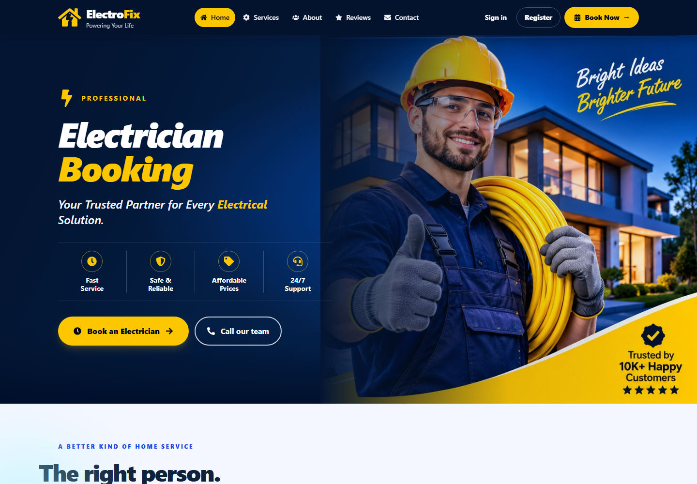
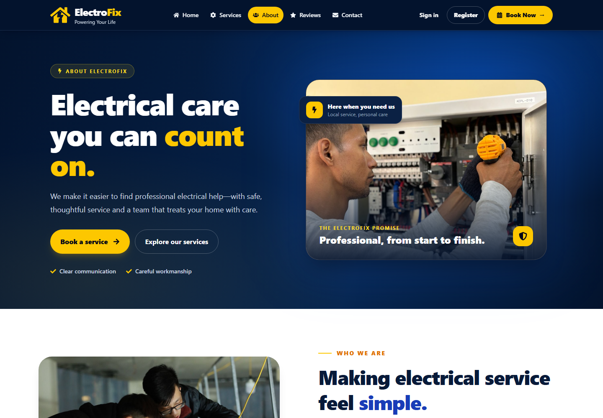
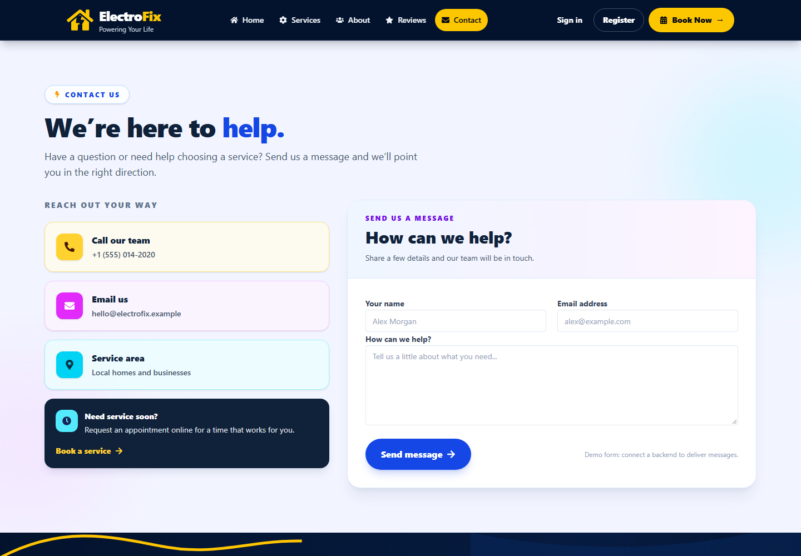
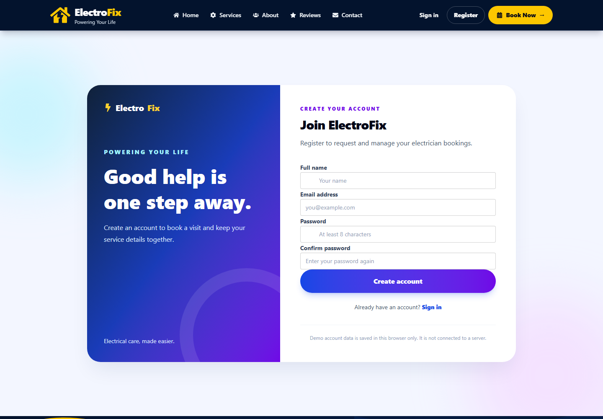
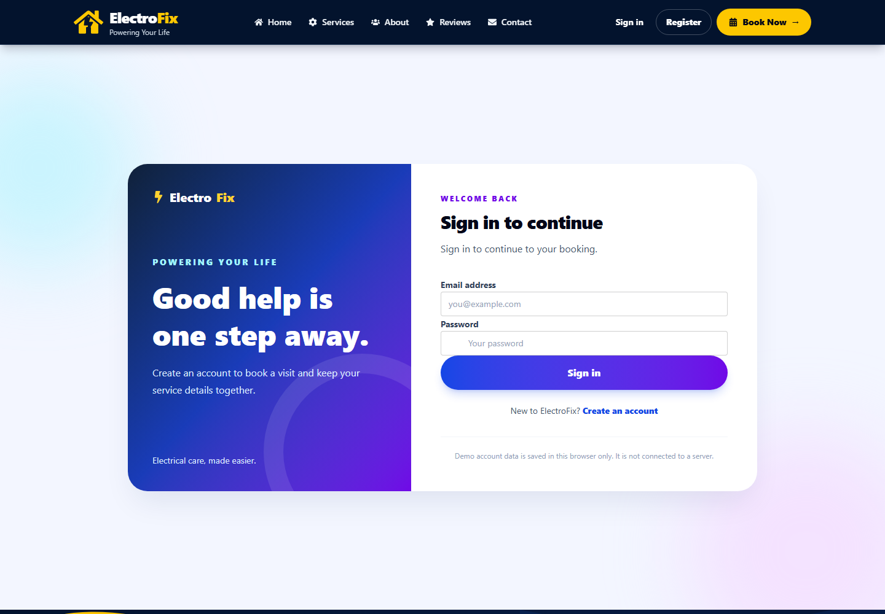
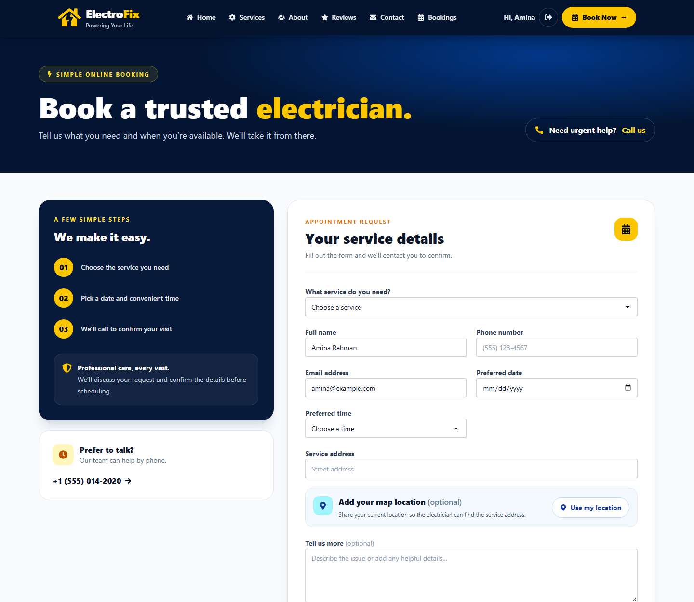
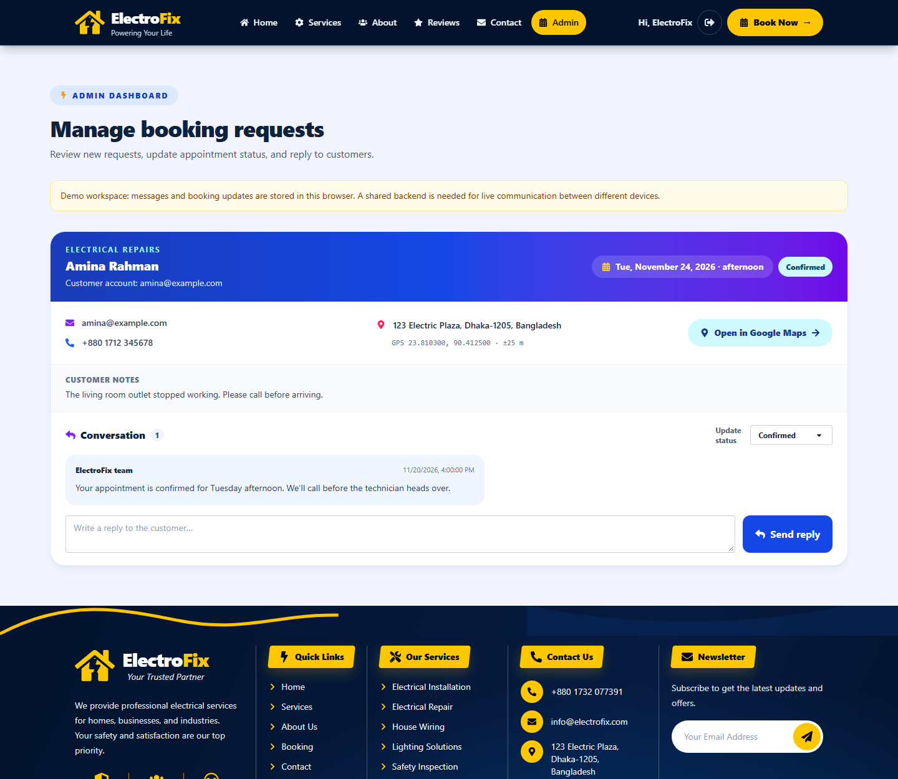
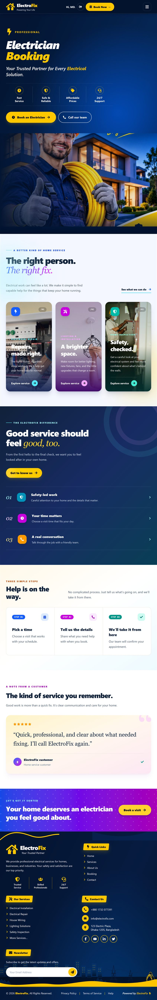

# ElectroFix — Electrician Booking

ElectroFix is a responsive electrical service booking website built with React and Vite. Customers can explore services, create an account, request an appointment, share an optional map location, and exchange replies about a booking.

## Pages

| Home | Services |
|:---:|:---:|
|  |  |

| About | Contact |
|:---:|:---:|
|  |  |

| Register | Sign in |
|:---:|:---:|
|  |  |

| Booking | Admin bookings dashboard |
|:---:|:---:|
|  |  |

<details>
<summary>View the full-page home screenshot</summary>
<br>

</details>

## Features

- Responsive home, services, about, and contact pages
- Customer registration and sign-in
- Booking form with service, contact, date, time, address, and notes
- Optional browser location sharing with a Google Maps link
- Customer booking list and conversation thread
- Admin booking dashboard with status updates and customer replies
- Responsive navigation and booking calls to action

## Run locally

**Requirements:** Node.js and npm.

```bash
npm install
npm run dev
```

Vite prints the local development URL in the terminal.

## Admin demo

The default admin email is `admin@electrofix.com`. Register or sign in with that email to see the admin dashboard. To use another email for the local demo, set this in a `.env.local` file before starting Vite:

```env
VITE_ADMIN_EMAIL=your-admin@example.com
```

## Browser storage and production notes

This project currently has no backend. Accounts, booking requests, statuses, and replies are stored in the current browser’s `localStorage`. The admin dashboard is a frontend demo and is not secure access control; staff and customers on different devices cannot share or receive updates. A production launch needs a backend for account verification, authorization, booking storage, and messaging.

Location sharing is optional and requires the customer’s browser permission. Browser geolocation generally requires HTTPS, with localhost supported for development. If location access is declined, the dashboard can still open Google Maps using the entered address.

The contact and newsletter forms are demo interactions and do not send data to a server.

## Useful scripts

```bash
npm run dev      # Start the Vite development server
npm run build    # Create a production build in dist/
npm run preview  # Preview the production build locally
npm run lint     # Run Oxlint
```

## Built with

- React 19
- Vite 8
- React Router
- Tailwind CSS 4 and daisyUI
- React Icons
